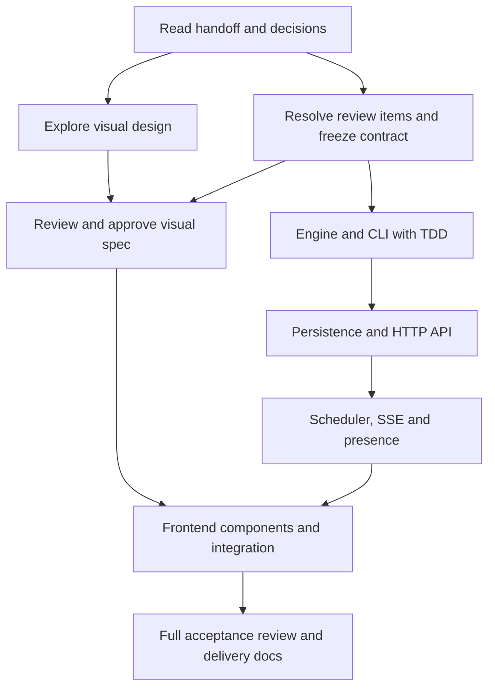

# How to use the Fleet Floor Simulator documents

This guide explains reading order, document combinations, and when to use each
prompt. It does not authorize implementation. The current chat remains planning
only; coding prompts are for a later session where implementation is requested.

## 1. Understand the document roles

| Document | Role | How to use it |
| --- | --- | --- |
| [HANDOFF.md](../../HANDOFF.md) | Entry point and scope summary | Read first in every fresh session |
| [DECISIONS.md](../../DECISIONS.md) | Confirmed behavior, assumptions, and reasoning | Consult before choosing or changing behavior |
| [ARCHITECTURE.md](../../ARCHITECTURE.md) | Ownership, boundaries, rationale, discussion | Read relevant sections for the current work |
| [Original brief](reference/BRIEF.md) | Source requirements | Check requirements/examples; distinguish them from confirmed interpretations |
| [REVIEW_ITEMS.md](REVIEW_ITEMS.md) | Review questions and resolutions | R1–R5 are resolved in D050–D060; consult before changing behavior |
| [CONTRACT.md](CONTRACT.md) | Backend/frontend boundary | Approved and frozen for the documented boundary; use for integration |
| [IMPLEMENTATION_PLAN.md](IMPLEMENTATION_PLAN.md) | Phases, dependencies, completion gates | Choose a bounded slice and its acceptance criteria |
| [ACCEPTANCE.md](ACCEPTANCE.md) | Behavioral test specification | Select examples to drive TDD; this is not an executed test report |
| [BACKEND.md](BACKEND.md) / [FRONTEND.md](FRONTEND.md) | Workstream briefs | Supply the one relevant to the selected slice |
| [prompts/](prompts/IMPLEMENT.md) | Task instructions for another agent/tool | Use the appropriate prompt with its referenced specifications |

Reading a prompt does not approve draft contract details. Confirmed user
decisions govern ambiguous brief behavior; recommendations and proposed field
names are not confirmed merely because they appear in a document. If sources
appear to conflict, surface the specific conflict rather than silently choosing.

## 2. Recommended sequence

1. **Orient:** HANDOFF -> DECISIONS -> relevant ARCHITECTURE sections.
2. **Resolve behavior/boundaries:** REVIEW_ITEMS + CONTRACT, checking the brief
   where necessary. Record the user's answers and update the contract/statuses.
   The user prefers resolving these questions before coding.
3. **Prepare visual design:** UI/UX prompt + FRONTEND + relevant contract and
   lifecycle constraints. Review the generated design before calling it approved.
   Visual exploration can happen while contract review is underway; unresolved
   behavior must stay labelled rather than become a new interaction requirement.
4. **Plan the next implementation slice:** IMPLEMENTATION_PLAN + ACCEPTANCE +
   the appropriate backend/frontend brief. Select explicit phase/slice IDs.
5. **Implement in an authorized coding session:** master implementation prompt +
   one workstream prompt + the selected specifications, using TDD.
6. **Review each completed slice:** review prompt + acceptance IDs + actual code,
   diffs, and results. Fix relevant defects before layering dependent work on top.
7. **Integrate and verify:** real API/database/SSE/browser flows, required CLI
   invocation, and documentation. Report incomplete work explicitly.



The diagram is a recommended dependency order, not a requirement to postpone all
UI work until the backend finishes. Once the contract is frozen, fixture-backed
UI components can be developed independently; real integration still needs the
backend. Separate workstreams do not themselves authorize parallel agents.

## 3. Document combinations by task

For a coding agent with repository access, give paths and require it to read
them. You do not need to paste every document into every message. For a tool
without file access, attach/paste the relevant packet. All packets include the
applicable confirmed decisions; use focused excerpts of the long architecture
record while keeping the full file available for questions.

| Task | Prompt to use | Supporting packet | Expected output |
| --- | --- | --- | --- |
| Resolve open decisions | A planning instruction, not IMPLEMENT | HANDOFF, REVIEW_ITEMS, CONTRACT, DECISIONS, relevant architecture/brief | User-reviewed answers and updated records; no code |
| Visual design | [UI_UX prompt](prompts/UI_UX.md) alone | FRONTEND, lifecycle/queue rules, relevant contract; HANDOFF for scope | Wireframes, tokens, component states, motion/accessibility specification |
| Engine | [Master](prompts/IMPLEMENT.md) + [Backend](prompts/BACKEND.md), phase 1/B1 | BACKEND, ACCEPTANCE E/L/P/B engine cases, domain decisions, reviewed snapshot types | Pure immutable engine and meaningful tests |
| CLI | Master + Backend, phase 2/B2 | BACKEND, ACCEPTANCE C cases, brief examples, parser/lifecycle decisions | Parser/runner, independent input/output fixtures, exact-output tests |
| Persistence and API | Master + Backend, phase 3/B3–B4 | CONTRACT, BACKEND, ACCEPTANCE D/A cases, failure/recovery decisions | SQL migrations, repository/application service, HTTP boundary tests |
| SSE and playback | Master + Backend, phase 4/B5 | CONTRACT, BACKEND, ACCEPTANCE S cases, presence/Pause decisions | Scheduler, stream/lease implementation and real HTTP tests |
| Frontend | Master + [Frontend prompt](prompts/FRONTEND.md), selected phase 5 slice | FRONTEND, frozen CONTRACT, ACCEPTANCE U cases, reviewed visual specification | Components/client integration and behavior tests |
| Review | [Review prompt](prompts/REVIEW.md), without an implementation instruction | Relevant code/diff, ACCEPTANCE, frozen contract, actual results and decisions | Ranked findings and regression suggestions; fixes only if authorized |

For phase 0 scaffolding, use Master + IMPLEMENTATION_PLAN and both workstreams'
configuration constraints. Do not ask the visual design tool to set workspace,
database, or engine architecture. Do not give a reviewer an implementation prompt
unless you also want changes made.

## 4. Example session starters

### Planning/contract review

```text
Planning only; do not write application code.
Read HANDOFF.md, DECISIONS.md, docs/handoff/REVIEW_ITEMS.md, and CONTRACT.md.
Discuss R1–R5 with me, explain the concrete trade-offs, and update the records
only when we agree. Preserve all confirmed behavior and record my pushbacks.
```

### Backend implementation, after the review gate

```text
Implementation is authorized for phase 1 / B1 only.
Use docs/handoff/prompts/IMPLEMENT.md followed by prompts/BACKEND.md.
Read the referenced specifications and select engine acceptance cases first.
Use TDD: run the failing test, implement, run green, then refactor.
Do not build the API or UI in this slice. Report actual results and remaining IDs.
```

Here and below, prompt paths after the first are relative to docs/handoff/.
Substitute phase 2/B2, phase 3/B3–B4, or phase 4/B5 for later backend sessions.

### UI/UX design tool

```text
Use the attached docs/handoff/prompts/UI_UX.md as the design assignment.
Use FRONTEND.md and the reviewed contract/lifecycle excerpts as constraints.
Produce the requested bright educational workbench design artifacts, not app code.
Mark exact colors and animation timings as proposals for my review.
Do not change robot, queue, playback, or persistence behavior.
```

### Frontend implementation

```text
Implementation is authorized for the selected phase 5 slice: [name the slice].
Use prompts/IMPLEMENT.md and prompts/FRONTEND.md from docs/handoff/.
Use the frozen CONTRACT.md and my reviewed visual specification.
Start with behavior tests. Use clearly identified contract fixtures if the
backend is unavailable; do not claim integration until tested against the real API.
```

If a fresh agent lacks the repository/documents, attach the relevant packet
rather than assuming it remembers this conversation. Replace placeholders before
execution. A missing phase or missing design approval is a question to resolve,
not permission to implement the entire app or invent a visual specification.

## 5. Keep TDD at the center of each coding slice

1. Choose a behavior and acceptance ID. Read its decision and Given/When/Then case.
2. Write a meaningful test and run it; confirm it fails for the intended reason.
3. Implement the smallest coherent behavior at the proper boundary.
4. Run targeted checks, then the affected package's checks.
5. Refactor with tests green; update actual completion evidence.

Use Vitest for engine/CLI/UI, Jest + Supertest for API/persistence, and Testing
Library for UI interaction. Use real SQLite and actual HTTP SSE tests where the
boundary is the subject of the test. Fake the application clock for deterministic
presence/scheduling tests; keep time sources out of the domain engine.

BDD examples define observable behavior; spec traceability connects it to tests;
DDD assigns responsibility. These complement TDD rather than replace running
red/green tests. No Cucumber dependency or arbitrary coverage percentage is needed.
Visual polish uses design review and targeted checks, not tests of CSS trivia.

## 6. Optional operating patterns

**One agent, sequential phases:** the simplest coordination model. Keep the same
contract, finish/review a slice, then issue the next phase prompt. A fresh session
can take over using the transfer note below.

**Separate backend and frontend sessions:** freeze the contract and shared JSON
fixtures first. Backend owns committed behavior and validation; frontend owns
rendering and interaction. Neither changes the boundary unilaterally. Review root
configuration/shared-type edits together and integrate real flows before completion.

**Design first:** generate and review wireframes/tokens/motion while planning the
backend. Save reviewed output in a clearly named location, for example a new
docs/design/ folder, and link it from FRONTEND.md. This path is a suggestion;
no design output or approval exists merely because it is named here.

**Independent review after each phase:** give the review prompt its code and
acceptance evidence, without the coding prompt. Return findings to the
implementation session. A separate session is optional; this guide does not
authorize spawning agents or require a particular model/tool.

## 7. Transfer context and keep documents current

At the end of a session, ask for a short transfer note:

```text
Phase/slice:
Acceptance IDs completed / remaining:
Files and contract version changed:
Actual commands and results:
Failing or unrun checks:
Decisions/questions resolved, with rationale:
Open questions and blocked dependencies:
Design artifacts reviewed versus still proposed:
Next recommended slice:
```

Update DECISIONS for confirmed behavior/assumptions, ARCHITECTURE for structural
rationale and discussion, CONTRACT for reviewed boundary changes, and
REVIEW_ITEMS for their resolution status. Do not call the contract frozen while
dependent review items remain open. Link material changes to affected acceptance
cases; do not generate duplicate contradictory specifications.

During actual implementation, maintain README.md, honest AI_USAGE.md, and
readable commits where permitted. Preserve rejected suggestions and real
corrections when useful; do not invent AI mistakes, tests, timings, or commits.
Five hours remains a planning target; the user decides when to stop or cut scope.

## Current recommended next step

R1–R5 are resolved and the documented boundary contract is frozen (D050–D062).
The visual specification is approved (D063). Do not start application
implementation in this chat or treat this usage guide as implementation approval.
